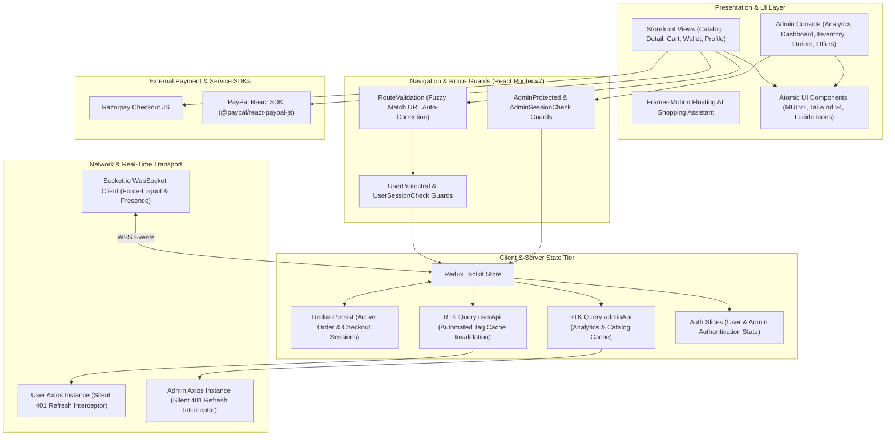
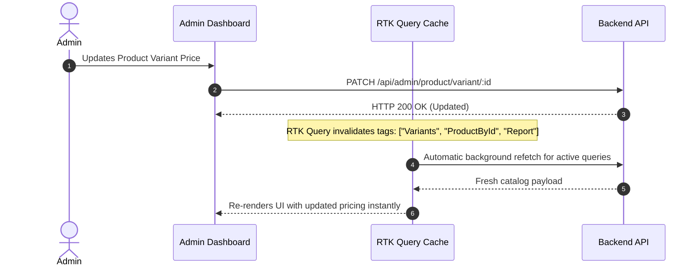
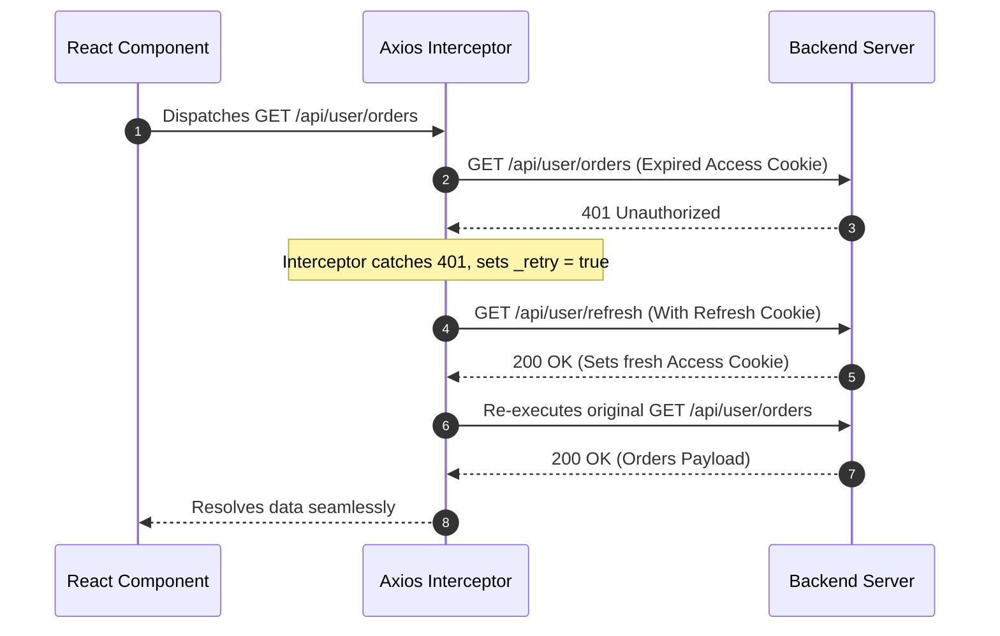

# Gratia E-Commerce Client Application (Frontend)

[](https://react.dev/)
[](https://vitejs.dev/)
[](https://redux-toolkit.js.org/)
[](https://tailwindcss.com/)
[](https://mui.com/)
[]()

> A high-performance, responsive Single Page Application (SPA) powering both consumer-facing storefronts and an enterprise administrative operations center. Built with **React 19**, **Vite 7**, and **Tailwind CSS v4**, featuring normalized server-state caching via **RTK Query**, transparent **401 Axios token rotation interceptors**, **Fuzzy URL category routing**, **real-time WebSocket state synchronization**, **failed payment retry pipelines**, and **Recharts analytics dashboards**.

---

## Architecture Blueprint

The client architecture is decoupled into distinct presentation, state, and transport tiers:



---

## Core Engineering Highlights

### 1. Hybrid State Management & Tag-Based Cache Invalidation
The application maintains a strict boundary between ephemeral client UI state and server-side cached state:
- **RTK Query Cache Normalization**: Both [`userBaseApi`](src/Store/Api/setup/userBaseApi.js) and [`AdminBaseApi`](src/Store/Api/setup/AdminBaseApi.js) utilize declarative cache tagging (`Auth`, `Orders`, `Product`, `Variants`, `Category`, `Coupons`, `Report`, etc.). 
- **Zero-Latency Invalidation**: Administrative operations (e.g., updating SKU variant pricing or changing order statuses) automatically invalidate dependent tag keys, guaranteeing immediate UI reconciliation across all active subscribers without manual refetching.
- **Session Persistence**: Checkout pipelines and multi-step transaction drafts are wrapped in `redux-persist` (`order-v2`), protecting consumer inputs across network drops and browser reloads.



---

### 2. Transparent Token Refresh via Axios Interceptors
Authentication security utilizes `HttpOnly` cookie-based JWT tokens. To guarantee an uninterrupted customer experience when the short-lived access token expires:
- **401 Interception**: The Axios response interceptor intercepts any `401 Unauthorized` response on protected endpoints.
- **Silent Token Rotation**: Pauses the failing request, tags it with `_retry = true`, and dispatches an asynchronous call to `/api/user/refresh` (or `/api/admin/refresh`).
- **Idempotent Replay**: Upon successful token rotation, the interceptor re-executes the original request with the fresh credential cookies, rendering session expiration invisible to the user.



---

### 3. Intelligent URL Routing & Algorithmic Fuzzy Auto-Correction
Deep-linked hierarchical category URLs (`/:category/:subCategory/:thirdCategory`) are protected by [`RouteValidation.jsx`](src/Components/Protected/RouteValidation.jsx):
- **Algorithmic String Similarity**: Employs the **Sørensen–Dice coefficient algorithm** (`string-similarity`) to compare user-typed URL slugs against available database categories.
- **Auto-Correction Redirect**: If a user enters a slightly misspelled route (e.g. `/electrnics/lap-tops`), the component calculates match confidence:
  $$\text{Similarity}(S_1, S_2) = \frac{2 |S_1 \cap S_2|}{|S_1| + |S_2|} > 0.4$$
- **Canonical Routing**: Automatically updates the browser location via `navigate(..., { replace: true })` to the canonical URL slug, preserving SEO equity and mitigating 404 dead-ends.

---

### 4. Unauthenticated-to-Authenticated Cart Synchronization
To maximize e-commerce conversion, guests can browse and add items to a persistent cart stored locally in browser `localStorage`:
- **Login Ingestion**: Upon successful authentication, [`App.jsx`](src/App.jsx) detects cached local items via `localStorage.getItem("cart")`.
- **Atomic Bulk Ingestion**: Dispatches `useAddToCartMutation` to bulk-upload guest items to the backend MongoDB cart collection.
- **Cache Eviction**: Automatically unlinks local storage entries, establishing the database as the unified source of truth.

---

### 5. Real-Time Socket.io Security Gateway & Instant Force-Logout
- **Session Registration**: On application boot, active authenticated users emit `registerUser` with their `userId` to the WebSocket gateway.
- **Administrative Ejection**: The client listens for the `forceLogout` event. If an administrator flags or blocks a user, the application instantly:
  1. Purges the Redux authentication slice (`clearUser()`).
  2. Executes the server-side logout mutation.
  3. Displays a security alert via `react-hot-toast`.
  4. Bounces the client to `/login` without waiting for token expiration.

---

### 6. Resilient Payment Orchestration & Checkout Recovery
The checkout subsystem supports multiple payment rails with a dedicated **Failed Transaction Recovery Engine**:
- **Multi-Rail Checkout**:
  - **Razorpay**: Direct checkout script integration with programmatic callback handling and signature forwarding.
  - **PayPal**: Native `@paypal/react-paypal-js` button integration with order creation and capture flows.
  - **Digital Wallet**: Real-time balance check and single-click checkout with automated ledger debit.
  - **Cash on Delivery (COD)**: Address validation and instant order generation.
- **Idempotent Retry Flow (`/checkout/retry/:id`)**:
  - When an online payment fails or times out, the backend persists the order in a `Failed` state.
  - The client loads [`CheckoutRetry.jsx`](src/Pages/User/CheckoutRetry.jsx), hydrating the exact order state (items, discounts, applied coupon, and address).
  - The customer can re-attempt the transaction across alternative payment methods without repeating product selection.

---

### 7. Interactive Administrative Analytics Dashboard
The administrative operations center ([`Dashboard.jsx`](src/Pages/Admin/Dashboard.jsx)) provides real-time business telemetry:
- **Composable Data Visualizations**: Built with **Recharts**:
  - `SalesLineGraph`: Multi-point revenue and sales volume trends.
  - `OrderStatusChart`: Donut/Pie distribution of order lifecycle stages.
  - `BarGraph`: Comparative performance across dates.
- **Time-Series Filtering**: Filter by daily, weekly, monthly, yearly, or custom date ranges using **MUI X-Date-Pickers**.
- **Top 10 Metrics**: Live ranking widgets for top-selling products, categories, and brands.
- **Direct Streaming Export Triggers**: One-click download triggers for server-generated PDF and Excel workbooks with zero client-side calculation overhead.

---

### 8. Client-Side Canvas Image Processing & Media Tools
- **Aspect-Ratio Image Cropping** ([`ImageCropper.jsx`](src/Components/Admin/ImageCropper.jsx)): Incorporates `react-easy-crop` and an HTML5 Canvas pipeline (`getCroppedImg`) to crop, scale, and compress images directly in browser memory before dispatching to Cloudinary.
- **Interactive Product Inspection**: High-resolution zoom inspection (`react-inner-image-zoom`) combined with `Swiper` touch carousels for multi-variant thumbnail galleries.

---

### 9. Contextual AI Shopping Assistant
- **Floating Widget** ([`ChatBox.jsx`](src/Components/User/ChatBox.jsx)): Smooth entry/exit physics using **Framer Motion**, animated typing indicators, and auto-scrolling message streams.
- **RAG-Grounded Queries**: Connects to the backend AI assistant to answer natural language product, stock, and pricing queries in real time.

---

## Directory & Module Anatomy

```
Frontend/src/
├── Assets/                      # Static branding, placeholders & SVG icons
├── Components/                  # Reusable UI component modules
│   ├── Admin/                   # Administrative interface components
│   │   ├── AdminLayout.jsx      # Navigation shell & collapsible sidebar
│   │   ├── DashBoxes.jsx        # Telemetry KPI metric cards
│   │   ├── ImageCropper.jsx     # Canvas-based client-side image cropping
│   │   ├── LineGraph.jsx        # Recharts trend visualization
│   │   ├── OrderStatusModal.jsx # Lifecycle status transition modal
│   │   ├── PiChart.jsx          # Order status distribution pie chart
│   │   ├── ProductTable.jsx     # Paginated SKU & inventory grid
│   │   └── SalesLineGraph.jsx   # Revenue analytics graph
│   ├── Protected/               # Routing guards & access control
│   │   ├── AdminProtected.jsx   # Admin authentication gate
│   │   ├── AdminSessionCheck.jsx# Login session redirection
│   │   ├── RouteValidation.jsx  # Fuzzy match category validator
│   │   ├── UserProtected.jsx    # Consumer authentication gate
│   │   └── UserSesssionChech.jsx# Guest session redirection
│   └── User/                    # Consumer storefront components
│       ├── ChatBox.jsx          # AI shopping assistant floating widget
│       ├── Header.jsx           # Dynamic navigation header & cart badge
│       ├── PaypalButton.jsx     # PayPal SDK button integration
│       ├── ProductCard.jsx      # SKU catalog display card
│       ├── ProductZoom.jsx      # High-res image inspection zoom
│       ├── Razorpay.jsx         # Razorpay checkout script trigger
│       ├── Search.jsx           # Debounced search bar with auto-suggestions
│       └── SelectCouponModal.jsx# Coupon selector modal
├── Error/                       # Error boundaries & fallback views
│   └── ErrorBoundary.jsx        # React class-based error boundary
├── Layout/                      # Shared page templates
│   └── MyAccountLayout.jsx      # Consumer account dashboard shell
├── Pages/                       # Top-level route views
│   ├── Admin/                   # Admin pages (Dashboard, Products, Orders, Offers)
│   └── User/                    # Storefront pages (Home, Catalog, Checkout, Wallet)
├── Routes/                      # Sub-router declarations
│   ├── Admin.route.jsx          # Admin routes & nested layout mappings
│   └── User.route.jsx           # Storefront consumer route tree
├── Store/                       # State management architecture
│   ├── Api/                     # RTK Query service definitions
│   │   ├── admin/               # Admin endpoints (Products, Orders, Reports)
│   │   ├── setup/               # Base queries & Axios instances
│   │   │   ├── Instances/       # Axios instances with 401 retry interceptors
│   │   │   ├── AdminBaseApi.js  # Admin RTK Query root with tag definitions
│   │   │   ├── axiosBase.js     # Custom Axios base query adapter
│   │   │   └── userBaseApi.js   # User RTK Query root with tag definitions
│   │   └── user/                # User endpoints (Auth, Cart, Orders, Wallet)
│   ├── StoreSlices/             # Pure Redux state slices
│   │   ├── adminAuthSlice.js    # Admin session state
│   │   ├── cartSlice.js         # Client-side cart operations
│   │   ├── orderSlice.js        # Checkout items, active coupons & pricing
│   │   ├── uiSlice.js           # Modal visibility & catalog filter parameters
│   │   └── userAuthSlice.js     # User session state
│   └── store.js                 # Redux store & redux-persist configuration
├── Utils/                       # Pure utility functions & canvas crop helpers
│   ├── getCroppedImg.js         # HTML5 Canvas image crop algorithm
│   └── ProtectedRoute.jsx       # Route wrapper factory helpers
├── WebSocket/                   # Real-time WebSocket connection
│   └── socket.js                # Singleton Socket.io client instance
├── App.jsx                      # Application shell & socket listener
├── main.jsx                     # Root bootstrap & provider composition
└── index.css                    # Tailwind CSS v4 design tokens
```

---

## Route Configuration & Access Control Matrix

| Path | Component | Guard / Access Level | Description |
| :--- | :--- | :--- | :--- |
| `/` | `Home` | Public | Storefront landing page, hero sliders & featured SKUs |
| `/:category/:sub?/:third?` | `ProductListing` | `RouteValidation` | Catalog with fuzzy match autocorrection |
| `/search` | `ProductListing` | Public | Full-text catalog search with filter sidebar |
| `/product/:id` | `ProductDetails` | Public | SKU details, image zoom & variant selection |
| `/cart` | `Cart` | Public / User | Cart management with live stock verification |
| `/checkout` | `Checkout` | `UserProtected` | Multi-rail checkout with address & coupon selection |
| `/checkout/retry/:id` | `CheckoutRetry` | `UserProtected` | Failed order payment recovery pipeline |
| `/myAccount/*` | `MyAccountLayout` | `UserProtected` | Account profile, address book, wallet, and orders |
| `/admin/login` | `AdminLogin` | `AdminSessionCheck`| Administrative dashboard login |
| `/admin` | `Dashboard` | `AdminProtected` | Executive analytics dashboard & reporting |
| `/admin/products` | `Products` | `AdminProtected` | SKU catalog, pricing & variant management |
| `/admin/orders` | `AdminOrders` | `AdminProtected` | Line-item order lifecycle & status management |
| `/admin/orders/return/requests` | `ReturnRequests` | `AdminProtected` | Return request approval & automated wallet refunds |


---

## Local Setup & Production Build

```bash
# 1. Install dependencies
npm install

# 2. Launch Vite development server with HMR
npm run dev

# 3. Compile optimized production build (Tree-shaken ES modules)
npm run build

# 4. Preview production build locally
npm run preview

# 5. Format and Lint source files
npm run format
npm run lint
```
